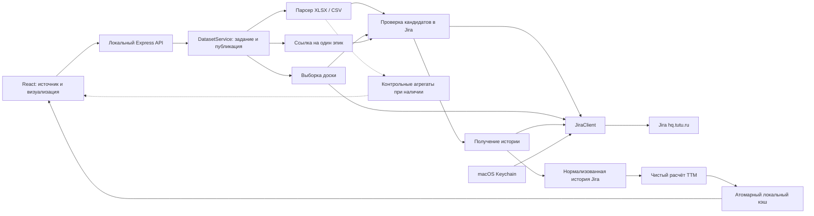

# Технический план: HF-эпики из файла, Jira-доски и ссылки на эпик

Дата: 23.09.2026. Основание: [бизнес-план v2, Q1–Q3 и дополнения S9/S10](PLAN-HF-Status-Continity.md). [Предыдущий аудит](REVIEW-HF-Business-Requirements.md) сохраняет историю решений; текущий объём определяется бизнес-планом с S9/S10.

Документ фиксирует целевую реализацию и критерии приёмки. Разработка начата по команде пользователя с TDD/BDD; фактические результаты и незакрытые зависимости G0 приведены в [отчёте реализации](IMPLEMENTATION-HF-STATUS.md). При подготовке исходного плана сетевые проверки не выполнялись; последующие живые проверки проводятся только в отдельно разрешённом объёме.

## Статус проектных решений после проверки

Модули, контракты, алгоритмы и численные параметры ниже — предложения реализации, а не дополнительные требования, якобы сформулированные пользователем. Они должны обеспечивать подтверждённый результат и не менять его объём.

| Обозначение | Статус и применение ко всему документу |
| --- | --- |
| Q1 | Решено: отклонённые эпики исключаются, в том числе видимые на доске. |
| Q2 | Решено: HF определяется текущей Jira. Файл задаёт кандидатов; их старые признаки не исключают ключ до проверки актуальных HF/резолюции в Jira. Единая политика при импорте и refresh. |
| Q3 + S9 | Три режима — доска, файл CSV/XLSX и ссылка на конкретный эпик. Во всех история из Jira. Прежний автономный код и кэш — совместимость, не дополнительный режим интерфейса. |
| S10: файл | Для импорта достаточно ключей. Название, HF/DF, резолюция, статусы, даты, TTM и история не обязательны в файле; необходимые сведения получаются через API Jira. |
| S10: Открыто | Первоначальное Открыто видно на календаре, но исключено из TTM, сумм этапов, heatmap и возвратов. Эпик до начала работы остаётся видимым с «TTM ещё не начат»; последующее `↩О` внутри TTM учитывается. |
| Граница объёма | Пользовательская отмена не подтверждена и не включена в реализацию ниже. Внутренний AbortSignal используется для таймаутов, остановки сервера и прекращения запросов после фатальной ошибки. |
| T-DEFAULTS | Одно задание, только ручной запуск, `asOf` в начале задания, число повторов, размеры и пределы выборки — технические предложения. Числа не заданы пользователем; ограничения не отменяют требования «все HF». |

Q1–Q3 закрыты ответом S8 и дополнены S9/S10. Это не превращает остальные технические предложения в прямые требования пользователя и не даёт разрешения на живую диагностику.

## 1. Объём и технические решения

- Сохранить React, TypeScript, Express, Vite, Zod, SheetJS и Vitest. Не вводить базу данных, облачный сервер, браузерную автоматизацию или MCP-зависимость в приложение.
- Источник кандидатов: файл CSV/XLSX с ключами, доска или Jira-ссылка на один эпик. Контрольный пример доски — `1482` по ссылке `https://hq.tutu.ru/secure/RapidBoard.jspa?rapidView=1482&projectKey=HOTELS`; другие id этим примером не исключаются.
- Источник истории и актуальных признаков отбора во всех трёх режимах — Jira. DF, не-эпики и отклонённые исключаются с причинами. Отдельный автономный импорт в интерфейсе v2 не предусмотрен.
- Для доски воспроизводятся её постоянные настройки, без быстрых фильтров и поиска открытой вкладки. `projectKey` не превращается в дополнительный фильтр.
- Выборка, загрузка истории, расчёт и публикация результата — разные стадии. Расчётный модуль не читает сеть, часы, Keychain или файловую систему.
- Локальный сервер остаётся на `127.0.0.1:4317`; браузер не соединяется с Jira. Все Jira-запросы выполняет Node-процесс.
- В первой версии одновременно выполняется одно задание. Обновление запускается пользователем. Инкрементальное получение только новых переходов отложено: на каждом обновлении проверяется полная история.
- Правила TTM и пороги heatmap сохраняются. Отображаемое первоначальное Открыто хранится отдельно от интервалов TTM и не добавляется к метрикам. Неизвестные статусы не получают автоматически смысл или пороги похожих названий.

## 2. Архитектура



Новые серверные модули не импортируются из `src/` или `shared/`. Получение PAT передаётся клиенту через серверную зависимость; типы ответа браузеру не содержат credential provider или параметры процесса Keychain.

| Файл / область | Ответственность |
| --- | --- |
| `server/jira/config.ts` | Фиксированный origin, лимиты, выбор Keychain service и проверенный профиль API. |
| `server/jira/keychain.ts` | Чтение PAT и безопасные ошибки доступа, без логирования вывода процесса. |
| `server/jira/client.ts` | GET-запросы, авторизация, таймауты, повторы, ограничения ответов, AbortSignal. |
| `server/jira/adapter.ts` | Изоляция особенностей конкретной версии Jira; проверка схем ответов. |
| `server/jira/board.ts` | Разбор ссылки, постоянные настройки, все страницы выборки, контроль её стабильности. |
| Новый `server/jira/epic.ts` | Разбор ссылки на эпик, разрешение ключа в issue id, обновление той же задачи без запроса доски. |
| `server/jira/history.ts` | Полный changelog и метаданные; проверка полноты и согласованности. |
| `server/jira/normalize.ts` | Преобразование Jira-событий в общую историю статусов/флагов. |
| `server/import.ts`, новый `server/import-csv.ts` | Извлечение кандидатов и исходных показателей; автономная политика отбора отдельно от режима с Jira. |
| Новый `server/selection.ts` | Отбор HF, исключения и причины, источник каждого признака. |
| `server/service.ts` | Стадии задания, публикация, правила refresh всех трёх источников. |
| `server/timeline.ts` | Чистый расчёт TTM и отдельные начальные интервалы Открыто; адаптер прежних интервалов файла. |
| `shared/calendar.ts`, `shared/layout.ts`, `shared/metrics.ts` | Диапазон по отображаемым интервалам, подписи первоначального Открыто, метрики только внутри TTM. |
| `server/cache.ts`, новый `server/cache-migrations.ts` | Схема v3, проверка, миграция v2 и атомарное сохранение. |
| `shared/types.ts`, новый `shared/contracts.ts` | Доменные типы и безопасные контракты локального API. |
| `src/api.ts`, новый `src/useImportJob.ts` | HTTP-клиент, polling, завершение локальных запросов, восстановление после перезапуска. |
| `src/SourceForm.tsx`, `src/DatasetSummary.tsx`, `src/App.tsx` | Выбор источника и режима, сведения о наборе, существующая визуализация. |

Не дробить текущий интерфейс целиком: выделить только форму источника, состояние задания и сведения о наборе, которые меняются в этой задаче.

## 3. Модель данных v3

### 3.1. Источник и выборка

Вместо обязательных `filename/sheet/sourceRow` для любого набора ввести дискриминируемые источники:

Для новых заданий всех трёх режимов `historyMode` равен `jira`. Чтение старого кэша с источником `file-intervals`/агрегатами сохраняется отдельной совместимой схемой `LegacyFileSource`; оно не создаёт дополнительного режима загрузки в интерфейсе. Входной DTO содержит только файл или URL; сервер сам заполняет разрешённые id и метаданные источника.

```ts
type SourceDefinition =
  | {
      kind: 'file';
      format: 'xlsx' | 'csv';
      filename: string;
      sheet: string | null;
      historyMode: 'jira';
      importedAt: string;
    }
  | {
      kind: 'board';
      origin: 'https://hq.tutu.ru';
      boardId: string;
      boardName: string;
      url: string; // каноническая ссылка без временных фильтров
      visibility: 'persistent-settings';
      historyMode: 'jira';
    }
  | {
      kind: 'epic';
      origin: 'https://hq.tutu.ru';
      requestedKey: string;
      key: string; // актуальный ключ после разрешения
      issueId: string;
      url: string; // каноническая ссылка на разрешённую задачу
      historyMode: 'jira';
    };

type SelectionDecision =
  | 'included' | 'excluded-df' | 'excluded-rejected'
  | 'excluded-not-epic' | 'unresolved' | 'invalid';

type LegacyFileSource =
  Omit<Extract<SourceDefinition, { kind: 'file' }>, 'historyMode' | 'format'>
  & { format: 'xlsx'; historyMode: 'file' };
```

- `SourceCandidate`: исходный ключ, стабильный Jira issue id после разрешения, актуальный ключ, ссылка на строку файла при её наличии, предоставленные метаданные и агрегаты. Неразрешённый кандидат ещё не является `EpicSummary` с заведомым `type: HF`.
- В `EpicSummary` сделать происхождение строки условным для файлового источника; доске/прямой ссылке не присваивать фиктивный `sourceRow = 0`. Пустые контрольные агрегаты допустимы. Для подтверждённого HF основные название/резолюция/метаданные берутся из Jira; исходные колонки остаются отдельными.
- `SelectionAudit`: найдено кандидатов, дубликаты, включённые, исключённые и неопределённые строки с причинами. Ключи и счётчики должны сверяться между собой.
- В аудите фиксировать решение для каждого уникального кандидата и ссылки на все его строки. `unresolved` не означает DF или исключение: при недоступных метаданных HF неизвестен. Такой ключ показывается в сведениях об отборе, а `EpicSummary { type: 'HF' }` создаётся только после подтверждения HF. Уже подтверждённый HF с недоступной историей остаётся строкой таблицы.
- Различать число входных строк, уникальных ключей и уникальных разрешённых issue id. Старый и новый ключи одной задачи объединяются после разрешения id, при этом сохраняются обе ссылки на источник. Итоговые счётчики выводить из окончательного аудита после контрольного чтения метаданных, а не из накопленных до переотбора инкрементов.
- Для файла сохранять исходный набор корректных ключей кандидатов и разрешённые issue id. Новые задачи вне этого набора появляются только с новым файлом; переименование ключа того же issue id не добавляет кандидата. На refresh пересматривать HF/резолюцию в Jira для всех кандидатов, включая ранее исключённых; отображаемый состав может измениться. Показывать причины и источник отбора.
- Для доски при каждом refresh полностью пересчитывать набор кандидатов. Стабильный issue id использовать для дедупликации и переименованных ключей.
- Для отдельного эпика refresh перечитывает сохранённый issue id, проверяет текущую пригодность и получает историю только этой задачи. Изменение ключа не меняет объект анализа. Входная неразрешённая ссылка хранится в задании; завершённый источник создаётся после разрешения issue id.
- `projectKey` из URL хранить только при необходимости пояснить исходную ссылку; запрос выборки не строить как `project = HOTELS`.
- Исходные значения файла и свежие данные Jira хранить в разных полях. Для отбора приоритет имеют текущие данные Jira (Q2); расхождения доступны в деталях. Текущее состояние Jira и состояние на расчётный срез не смешиваются с признаками из файла.

### 3.2. Общая история

Заменить `TableHistory` на `HistorySnapshot`, не потеряв адаптер существующих таблиц:

- `source: 'jira' | 'file-intervals'` и `fetchedAt` для источника;
- начало предоставленного покрытия, подтверждённое начальное состояние и наблюдавшееся конечное состояние;
- `statusChanges`, `flagChanges` с точными timestamps;
- для Jira — `historyId`, `itemIndex`, исходный порядок, status id и историческое отображаемое имя;
- раздельные признаки `statusCoverage` и `flagCoverage`: `complete | partial | unavailable`;
- доказательства полноты: ожидаемое/полученное число записей, признак конца пагинации, границы покрытия, версия проверенного адаптера;
- `observedUpdatedAt` и время повторной проверки метаданных;
- нормализованные предупреждения без сырых HTTP-ошибок.

Счётчик строк интервалов файла не считать счётчиком changelog Jira. Полнота предоставленной таблицы означает непрерывность переданного покрытия, а не доказательство наличия всей истории Jira с создания задачи.

Для внутренних связей переходов предпочитать status id. Переименование статуса не должно создавать ложный разрыв из-за различающихся названий. Названия сохраняются для отображения. Если id нет, использовать проверенный порядок и нормализованные имена с явным ограничением.

### 3.3. Набор и качество

`DatasetV3` содержит `schemaVersion: 3`, id, источник, `asOf: string | null`, `syncStartedAt/syncFinishedAt: string | null`, `savedAt`, аудит выборки, эпики и предупреждения. Для новых Jira-заданий времена синхронизации и asOf обязательны. В старом автономном наборе неизвестные времена синхронизации равны null; для одних агрегатов без момента среза `asOf` также null. Время импорта не подставляется вместо момента исходных данных. Определение доски дополнительно содержит fingerprint постоянных настроек и проверенную семантику получения выборки.

Разделить полноту выборки, истории статусов и impediment. Старое `quality: complete | partial` можно сохранить как сводное отображение, но не использовать для решения, можно ли публиковать неполную выборку доски. Устаревший сохранённый набор — состояние загрузки/времени, не синоним неполной истории.

В аудите отдельно хранить `sourceCoverage` (все ли кандидаты источника получены) и `eligibilityCoverage` (проверены ли HF/резолюция всех кандидатов). В эпике — `statusCoverage`, `flagCoverage` и `ttmState`. Полная история с неизвестной картой статусов может дать `indeterminate`; неизвестный impediment не отменяет корректный TTM; `not-started` при полной истории не снижает качество сам по себе. На уровне набора не выводить complete только из `epics.every(...)`: пустая таблица с unresolved-кандидатами не является полной пустой выборкой.

Модель эпика должна различать «не вошёл в активный этап», «история недоступна» и «расчёт невалиден». Отсутствие TTM не равно нулю и не всегда означает ошибку чтения.

### 3.4. Отображение отдельно от расчёта

Расширить `EpicTimeline`, сохранив значение существующего `intervals` как интервалов только внутри TTM:

- `ttmState: 'not-started' | 'running' | 'finished' | 'indeterminate' | 'not-present'`;
- `initialOpenIntervals: StatusInterval[]` — подтверждённое первоначальное Открыто вне TTM с подписью «Открыто», не `↩О`;
- `displayStart/displayEnd: string | null` — границы объединения отображаемых первоначальных и TTM-интервалов;
- `start/end`, `ttmMs`, `returnToOpenMs`, `durations` по-прежнему относятся исключительно к TTM;
- представление `displayIntervals` строится из двух массивов с ролью `initial-open | ttm`; оно не является входом расчёта метрик.

При `not-started` TTM-границы и метрики равны `null`, `intervals = []`; подтверждённое Открыто присутствует в `initialOpenIntervals`. Это допустимый результат, а не ошибка. При `indeterminate` неизвестные метрики остаются `null`, причина указывается явно. Значение `0` допустимо у начавшегося нулевого интервала, но не заменяет отсутствие TTM.

`isOpen`, если остаётся для совместимости рендера, выводится только из `ttmState === 'running'`; это не проверка `currentStatus !== closed`. `displayStart/displayEnd` и `displayIntervals` — производные представления; сохранять их вместо исходной истории как единственное доказательство расчёта нельзя.

## 4. Диагностика совместимости — G0

До реализации рабочего адаптера подготовить `scripts/verify-jira.ts`. По умолчанию он только показывает план запросов без Keychain и сети. Флаг выполнения сам по себе не заменяет отдельное разрешение пользователя на живую проверку.

После разрешения проверить минимальный набор:

1. Доступность согласованной записи Keychain, успешную аутентификацию и идентификатор пользователя без вывода PAT.
2. Вариант/версию Jira и доступные документированные операции чтения. По выявленной версии сверить официальную документацию API до закрепления endpoint.
3. Метаданные и постоянные настройки доски 1482: тип доски, основной фильтр, подфильтр, колонки, скрытие завершённых задач и доступность этих настроек для PAT.
4. Схемы issue type, признака HF/DF, resolution, статусов и impediment. Нельзя считать поле «Вид эпика» типом потока.
5. Метаданные и всю историю выбранных эпиков, включая прямую ссылку и эпик без первого активного этапа при наличии такого примера. Состав диагностических запросов согласуется заранее; длинная история нужна для проверки окончания пагинации, короткая её не доказывает.
6. Как получить тот же набор эпиков, который видит пользователь на доске без быстрых фильтров. Если нужен контекст вне постоянных настроек, сформулировать конкретный вопрос пользователю; выбор спринта как новая функция заранее не согласован.

Результат G0: локальный обезличенный отчёт о возможностях и профиль адаптера со списком методов/путей, правилами пагинации, идентификаторами нужных полей и тестовыми схемами. Отчёт о реальных данных хранить в `.local-data/`, тестовые ответы создавать вымышленными.

**Условия перехода:** общий профиль должен подтвердить чтение метаданных, полной истории и начального состояния; профиль доски дополнительно подтверждает постоянную выборку. Недоступность доски не должна мешать файловому режиму или прямому эпику, если общие операции работают. При этом вся интеграция не считается принятой, пока один из трёх обязательных режимов заблокирован. Если способ чтения не установлен, зафиксировать конкретное ограничение; не переходить молча к первой странице changelog, всем эпикам проекта или недокументированному API браузера. Компоненты можно готовить на вымышленных данных до G0, но это не живая приёмка.

## 5. PAT и HTTP-клиент

### 5.1. Keychain provider

- Серверный интерфейс `getPat(signal): Promise<string>`; реализация через `execFile`/`spawn` системного `/usr/bin/security` с отдельными аргументами и без shell.
- Начальная согласуемая последовательность сервисов: `Code Jira Relations PAT`, затем `tutu-jira`. Список явно входит в разрешение на диагностику; произвольные записи Keychain не перечисляются.
- Альтернативную запись пробовать только при достоверном отсутствии основной. Отказ пользователя, заблокированный Keychain, неоднозначная запись и прочие ошибки не трактуются как разрешение обходить отказ другой записью.
- PAT читать один раз на задание и удерживать только в серверном контексте задания. По завершении удалять ссылки; не обещать гарантированное затирание JavaScript-строк из памяти.
- Отдельно классифицировать отсутствие записи, отказ доступа, таймаут и пустое значение. Сырые stdout/stderr и Error процесса не передавать в лог или API.
- macOS может запросить разрешение при первом обращении приложения. Не менять автоматически системные ACL Связки ключей или постоянные правила Codex.

### 5.2. Транспорт

- Зависимости: credential provider, `fetch`, clock, abortable delay и профиль адаптера. В тестах все заменяются локальными заглушками.
- Разрешить только HTTPS-origin `https://hq.tutu.ru`, стандартный порт, без userinfo и произвольных абсолютных путей от клиента. URL конструируется сервером из фиксированных путей адаптера и валидированных параметров.
- Для первой версии использовать только GET-операции Jira. Длинные списки ключей разбивать на ограниченные порции. Если конкретная версия потребует иной read-only метод, сначала изменить проверяемый контракт и область разрешения.
- Отключить автоматическое следование redirects. Заголовок `Authorization` не передавать по перенаправлению даже внутри логики повторов. TLS-проверку не отключать.
- Проверять статус, JSON и схему ответа. HTML страницы входа не считать пустым результатом Jira.
- Различать ошибку авторизации клиента и недоступность одной задачи. 401 прекращает задание и новые запросы; 403/404 для конкретного ключа дают соответствующую проблему кандидата/истории, не утверждение об истечении PAT. Отказ чтения настроек доски блокирует её режим. Не раскрывать якобы существующую скрытую задачу по одному 404.
- Начальные лимиты: до 4 параллельных запросов, 20 секунд на запрос, не более 3 попыток всего. Повторять сетевые временные ошибки, 429 и временные 5xx; не повторять 400/401/403/404 как временные ошибки.
- Для 429 учитывать `Retry-After`. При ожидании дольше 60 секунд завершать операцию с `RATE_LIMITED` и допустимым временем повторного запуска, а не отправлять запрос раньше указанного срока. Задержки отменяются через AbortSignal.
- Ограничить размер ответа, число страниц и общий объём нормализуемой истории. Достижение лимита — явная ошибка неполноты, не успешное усечение. Начальное ограничение ответа 20 МБ; конкретный предел истории проверить в G0.
- Ошибки очищать по белому списку полей: код, безопасное сообщение, стадия, ключ эпика, возможность повтора. Заголовки, тело ответа, содержимое Keychain и объекты HTTP-запросов не логировать.

## 6. Получение состава доски

Уточнение S12: пользователь подтвердил отсутствие скрытия завершённых на доске 1482. Проверенный локальный профиль этой доски фиксирует `completedVisibility: all`; переносить это значение на другие доски нельзя. Публичный ответ конфигурации Jira 9.12.10 не отдаёт само правило скрытия, поэтому его изменение требует повторного подтверждения.

### 6.1. Валидация ссылки

Поддерживаемый первый формат: `/secure/RapidBoard.jspa?rapidView=<положительный числовой id>`. Разбирать через `URL`; отклонять чужой origin, credentials, неправильный путь, повторяющийся или неоднозначный `rapidView`. Доска 1482 — контрольный пример, не единственный допустимый id в алгоритме.

Параметры временных фильтров не применять; сообщать об их игнорировании. Сохранять каноническую ссылку и режим `persistent-settings`. Не использовать введённый URL как готовый HTTP-запрос с PAT.

### 6.2. Адаптер выборки

```ts
interface BoardReader {
  readDefinition(boardId: string, signal: AbortSignal): Promise<BoardDefinition>;
  readCandidates(definition: BoardDefinition, signal: AbortSignal): Promise<BoardSelection>;
}
```

`BoardDefinition` содержит настройки, которые действительно участвуют в отображении, и fingerprint. `BoardSelection` содержит стабильные id/ключи, аудит страниц и `complete`. Не реализовывать `complete` как просто «HTTP вернул 200».

Алгоритм:

1. Прочитать и нормализовать определение доски D1.
2. Получить все страницы кандидатов в детерминированном порядке, если API его поддерживает; проверять движение cursor/startAt, терминальный признак и total, когда он предоставлен.
3. Дедуплицировать по issue id. Пропавшая страница, повтор cursor или изменяющийся total требуют проверки, а не завершения с укороченным списком.
4. Применить только подтверждённые G0 правила постоянной видимости. Не считать общий board filter равнозначным видимым карточкам без проверки колонок/подфильтров/скрытия завершённых задач.
5. Повторно проверить определение D2 и набор id. При изменении выполнить одну повторную попытку получения выборки; если набор продолжает меняться — `BOARD_CHANGED_DURING_READ`, без замены кэша.
6. Разрешить кандидатов в эпики и HF, исключить DF/не-эпики/отклонённые с причинами. Не добавлять родительские эпики задач, не представленные доской самостоятельно.
7. Зафиксировать выборку и время её чтения. Это согласованная проверенная выборка за интервал чтения, не доказательство атомарного снимка всех фильтров на одну миллисекунду.

Предлагаемые технические пределы — 1000 HF-эпиков на анализ и 10 000 кандидатов доски. Пользователь эти числа не задавал. Их применимость нужно проверить на требуемом объёме; превышение даёт `SELECTION_TOO_LARGE`, без молчаливого усечения. Такая ошибка означает ограничение реализации, а не выполнение требования «все видимые HF». Полная достоверно пустая доска — допустимый результат, который заменяет предыдущий набор пустым с объяснением; ошибка чтения доски не является пустым результатом.

### 6.3. Ссылка на отдельный эпик

Начальный формат разбора — `https://hq.tutu.ru/browse/<KEY>`; это предложение адаптера ссылок, а не утверждение, что пользователь уже предоставил пример такого URL. До живой приёмки проверить фактический формат ссылки пользователя. Путь и ключ разбирать через `URL` и общий валидатор ключей; чужой origin, userinfo, неоднозначный путь и пустой ключ отклонять до Keychain. Допустимые служебные query/hash не использовать как параметры REST-запроса и не сохранять в канонической ссылке.

Извлечь ровно один ключ, запросить минимальные метаданные, разрешить стабильный issue id и применить общий отбор. Для подходящего HF загрузить историю общим `HistoryReader`, без BoardReader, файла, родительских и дочерних задач. Недоступный ключ — ошибка с ключом источника; DF/отклонённый/не-эпик — явное исключение. Правила первоначального Открыто, TTM и неполноты одинаковы для всех источников.

При ошибке прямой ссылки прежний набор может оставаться на экране только с его собственным источником и явным сообщением «Новый эпик не загружен». Нельзя показывать предыдущую доску как результат запрошенного эпика. Достоверное исключение запрошенной задачи публикует пустой результат с её ключом и причиной, а не общую надпись «ничего не найдено».

## 7. Файловые источники и CSV

CSV и XLSX — подтверждённые форматы одного файлового режима. Оба дают кандидатов, отбор HF/резолюции и история берутся из Jira. Прежняя автономная обработка ниже нужна только для совместимости существующего контракта и сохранённых данных.

### 7.1. Минимальный контракт файла

В Jira-режиме обязательны только распознаваемые ключи. Не использовать прежние `PROFILES` с обязательными `title/type/resolution` или `status/weeklyTtm`, не создавать `EpicSummary` до разрешения Jira. `parseFileCandidates` не вызывает `readTableHistories`: листы переданной истории и агрегаты не заменяют Jira-историю и не становятся условием импорта.

- Поддержать одноколоночный CSV/XLSX с заголовком `Ключ`, `Ключ эпика`, `Ключ проблемы`, `Issue key` или `Key`, с нормализацией пробелов/регистра/BOM.
- Для однозначного одноколоночного списка без заголовка распознавать ключи как данные, включая первую строку. Не извлекать ключи из произвольного текста комментариев или нескольких неидентифицированных колонок.
- Пустые строки пропускать; некорректные ключи и дубликаты учитывать с номерами строк. Валидные ключи нормализовать и дедуплицировать, сохранив исходное происхождение. При отсутствии валидных ключей завершать разбор с понятной ошибкой до Keychain.
- Лист XLSX определять по колонке ключей, а не по активному листу и не по наличию необязательных полей. При неоднозначном выборе не угадывать и не объединять листы: сообщить названия кандидатов и предложить оставить один лист выборки.
- Из рассмотрения как выборки исключать структурно распознанные служебные листы переходов/параметров/impediment по схемам существующего `server/table-history.ts`, а не только по имени листа. Это классификация структуры, не чтение альтернативной истории. Проверить книгу с основной выборкой ключей и вспомогательными листами: добавление таких листов не должно менять набор. Два самостоятельных листа выборки по-прежнему неоднозначны.
- Отсутствие или неверное значение необязательных HF/DF, резолюции, названия, дат, статуса и агрегатов не отбрасывает валидный ключ. Неоднозначные необязательные поля можно пропустить с предупреждением; неоднозначность самой колонки ключей — ошибка структуры.

### 7.2. Разделение существующего импортера

Текущий `parseWorkbook` сразу отбрасывает строки и создаёт `EpicSummary`. Для режима Jira это мешает обогащать строки с отсутствующим признаком HF. Разделить:

1. `parseFileCandidates(buffer, format)` — структура, ключи и необязательные контрольные метаданные/агрегаты. Интервалы файла в Jira-задание не загружаются.
2. Прежние `parseWorkbook`/`readTableHistories` сохранить за отдельным адаптером совместимости XLSX, чтобы их обязательные поля и правила не попадали в новый парсер кандидатов.
3. `resolveJiraCandidates(...)` — чтение текущих признаков Jira для всех корректных ключей, отбор HF с исключением отклонённых и аудит расхождений.

Сначала извлечь все корректные ключи файла; прежние DF/отклонённые не отбрасывать до чтения текущих признаков Jira. Сохранить все ключи для следующих refresh, включая исключённые в текущем запуске. Невозможность проверить HF в Jira не компенсировать догадкой по файлу: кандидат остаётся неопределённым с причиной.

Метаданные кандидатов и история отобранных эпиков — разные стадии; полная история исключённых кандидатов не нужна.

### 7.3. CSV

- UTF-8 с/без BOM; неподдерживаемая кодировка вызывает понятную ошибку, не угадывается молча.
- Разделители `,`, `;`, tab; корректная обработка кавычек, вложенных переводов строк и пустых полей. Не использовать `split` по строкам/запятым.
- Использовать имеющийся парсер SheetJS в режиме сохранения исходных строк; подтвердить его поведение вымышленными тестами. Новая зависимость нужна только при выявленном пробеле возможностей.
- Читать матрицу, а не объект по заголовкам: CSV Jira содержит повторяющиеся названия пользовательских полей. Неоднозначную колонку ключа отклонять; необязательные неоднозначные поля пропускать с предупреждением, не блокируя выборку ключей.
- Добавить сопоставления: `Ключ проблемы → key`, `Название → title`, `Статус → currentStatus`, `Решение → resolution`, пользовательский `Вид эпика → epicKind`.
- Не считать `Тип задачи = Большая задача`, `Вид эпика` или `WIP Aging` доказательством HF/TTM. В новом файловом режиме HF определяется актуальными данными Jira независимо от признаков в CSV/XLSX.
- Сохранять только нужные поля. Описания, комментарии, email и весь исходный CSV не нужны для календаря и не копируются в кэш автоматически.
- Сохранить ограничения 20 МБ, 20 000 строк, 500 колонок и правила дубликатов ключей. Папка `temp_imports/` остаётся вне Git.

## 8. История, точное время и расчёт

Уточнение S11 от пользователя при реализации: «Решили делать» перед первым согласованным активным HF-этапом находится вне TTM. Хранить такие интервалы отдельно как `preTtmIntervals`, отображать с исходным названием и ролью `before-ttm`; не включать в метрики и heatmap. Они разрешены перед стартом и сами по себе не делают его неизвестным. При появлении этого статуса уже внутри TTM сохранять его время по прежнему правилу непрерывности, без выдуманного активного этапа или новых порогов. Профиль совместимости `legacy-v2` не пересчитывать по новому правилу. AC-06/07 дополнить сценарием Открыто → Решили делать → активный: TTM начинается только на активном этапе.

### 8.1. Проверка полноты и согласованности

1. Прочитать минимальные метаданные задачи M1 и полный changelog по проверенному в G0 протоколу.
2. Проверить доказательство конца истории и количество уникальных history records. Если сервер возвращает только окно истории и нет проверенного способа получить остальное, вернуть `HISTORY_TRUNCATED`.
3. Разобрать только необходимые изменения статуса и флага, сохранив порядок history record и item внутри него. Дедуплицировать повтор страницы по `(issueId, historyId, itemIndex)`, а не по времени и паре статусов.
4. Прочитать контрольные метаданные M2. Если задача менялась во время чтения и не удалось получить согласованный полный набор, повторить чтение один раз; затем пометить эпик неполным.
5. Проверить цепочку from/to и совпадение её конца с наблюдавшимся состоянием M2. Ошибку не исправлять добавленным вручную переходом.

При контрольном чтении M2 также сверить issue type, HF/DF и резолюцию с данными отбора. Изменившееся достоверное исключение отражается в `SelectionAudit`; история такого эпика не попадает в итоговую таблицу. Ошибка контрольного чтения не превращается в «подтверждённый HF». Записывать время наблюдения признаков отдельно от `asOf`: отбор по текущим данным не является историческим отбором на расчётный срез.

### 8.2. Срез

Единый момент расчёта и различение свежих/старых данных унаследованы из исходного плана. Выбор именно начала задания — техническое предложение T-DEFAULTS, не отдельный ответ пользователя.

- Для Jira `asOf` фиксируется один раз в начале задания. Если отменяется весь срез и запускается новое задание — новый `asOf`; локальный повтор чтения отдельного эпика не меняет общий срез. Для автономной истории используется явный `asOf` из таблицы; для одних агрегатов без среза — `null`.
- Полная полученная история может содержать события после `asOf`. Они нужны для проверки согласованности с M2, но не входят в длительности до среза.
- `ttmState` определять по истории, обрезанной на `asOf`, после проверки полной цепочки. Первый активный переход после среза оставляет на срезе `not-started`, даже если M2 уже активен. Событие ровно на `asOf` обрабатывать в порядке источника; оно может дать начавшийся TTM длительностью 0. Закрытие после среза не рисует финиш до него.
- Сначала проверить всю цепочку до наблюдавшегося состояния, затем отдельно вычислить состояние на `asOf`. Текущий статус и статус на срез отображаются с разными подписями, если различаются.
- Название/исполнитель из M2 помечаются временем получения; не заявлять, что все изменяемые метаданные восстановлены на `asOf`.
- Для вновь созданного после `asOf` кандидата не строить отрицательный интервал: показать причину отсутствия на срезе. При повторяющейся несогласованности переснять набор новым заданием.
- Выборка относится к интервалу чтения доски/файлу, временные расчёты — к `asOf`. Это ограничение отражается в данных и интерфейсе.

### 8.3. Нормализация событий

- Timestamps разбирать с явно переданным смещением; расчёт в миллисекундах, отображение Europe/Moscow.
- При одинаковом времени использовать подтверждённый порядок источника/history id и `itemIndex`. Если порядок нельзя подтвердить цепочкой from/to, считать историю неоднозначной; не сортировать названия статусов для получения удобного маршрута.
- Начальное состояние выводить из первого `from` только при подтверждённой полной истории. При полном отсутствии переходов допустимо использовать подтверждённое начальное состояние задачи; один текущий статус без доказательства полноты недостаточен.
- Полнота пагинации и известность начального состояния — разные проверки. При недоказанном начале покрытия не дорисовывать Открыто до даты создания и не объявлять `not-started`. При доказанном создании сразу в активном статусе начало TTM может совпасть с созданием; это следует из начального состояния, а не из подстановки даты при отсутствии истории.
- Дату создания использовать как границу покрытия истории Jira, не как автоматическое начало TTM. Начало TTM вычисляется по фактическому первому активному состоянию.
- Для impediment учитывать массивы/значения реального поля по схеме G0. Отсутствующее поле, `null`, пустое значение и недоступная история не смешиваются. Ноль допустим только при известном состоянии и полном покрытии.

### 8.4. Изменение расчётного модуля

Переиспользовать `calculateTimeline`, добавив отдельный нормализатор и явную проверку покрытия до вызова. Текущая сортировка только по времени и строковому id заменяется порядком нормализованных событий. Проверку статуса после среза выполнять отдельно от построения интервалов.

Построить подтверждённые интервалы статусов до `asOf`, затем разделить отображение и расчёт. Первоначальное Открыто до первого активного этапа попадает в `initialOpenIntervals`; TTM-интервалы — в `intervals`. Сумма только `intervals` совпадает с `end - start` в миллисекундах. Начальное Открыто не увеличивает TTM, активные длительности, `returnToOpenMs` или heatmap. После первого активного этапа Открыто остаётся `↩О` внутри TTM, включая текущий возврат.

Вместо безусловного раннего выхода `NO_ACTIVE_STATUS` различать доказанное отсутствие работы и недостаток данных. При полной истории только в первоначальном Открыто вернуть `not-started`, начальный интервал до `asOf` и сообщение «TTM ещё не начат», без «В работе». Если история неполна или есть неизвестный потенциально активный этап до известного начала — `indeterminate`, без выдуманного начала и нулевого TTM. Если задача создана после среза — `not-present`.

Начальное Открыто — только подтверждённый начальный участок до первого активного статуса. Открыто после неизвестного потенциально активного участка нельзя автоматически назвать первоначальным. Для полной цепочки без активного этапа, но с закрытием/неизвестным статусом, не показывать фиктивное текущее Открыто: TTM остаётся неопределённым с объяснением, фактические переходы доступны в деталях.

Сохранить полуоткрытые интервалы, повторы, промежуточные закрытия, нулевые события и точные переходы. Стрелка «В работе» относится только к `running`; сам по себе статус Открыто её не включает. Начало отображаемого Открыто опирается на подтверждённое начальное состояние и границу покрытия, не на догадку по текущему статусу.

Не менять глобальную классификацию `kind: 'open'` на новый активный этап. Сейчас `statusInfo` даёт любому Открыто код `↩О`; вынести выбор подписи/оформления в функцию представления с ролью сегмента. Начальному участку назначать «Открыто», возврату — `↩О`. Ни одна функция суммирования/heatmap не получает объединённый массив календаря.

Impediment нормализовать независимо от статусов, затем для существующего показателя пересекать его интервалы с границами TTM. Начальное Открыто не расширяет эту метрику, TTM никогда не уменьшается на время флага. Если TTM не начат или неопределён, `impedimentMs = null` как отсутствие расчётного диапазона; отдельно показывать, доступна ли история флага. Если TTM известен, а история флага недоступна — TTM остаётся, неизвестный флаг не превращается в ноль. Проверку флагов не терять из-за прежнего раннего выхода при отсутствии активного этапа.

Для `finished` отображение заканчивается окончательным закрытием; хвост пребывания в Закрыт до `asOf` не добавляется ни в TTM, ни в календарную полосу. Промежуточные закрытия до переоткрытия сохраняются внутри TTM. При `running` последний TTM-интервал оканчивается `asOf`; при `not-started` на `asOf` оканчивается только начальное Открыто без стрелки «В работе».

Для G0 начать с существующих восьми этапов. Если на доске есть дополнительные активные этапы, до их включения в начало TTM явно согласовать карту статусов. Не расширять текущий `Stage` фиктивным соответствием; дополнительный самостоятельный этап требует отдельного id, подписи, нейтрального оформления и отсутствия heatmap до согласования порогов. Неизвестные статусы внутри уже определённого TTM по-прежнему сохраняют длительность.

## 9. Контракты локального API

Это контракты приложения, не утверждение о доступных endpoint корпоративной Jira. Для всех POST сохраняются проверки локального Origin/Host и `X-Local-Request: 1`.

В новом интерфейсе CSV/XLSX всегда загружаются с явным `X-History-Source: jira`. Автономность прежнего XLSX API без заголовка — только обратная совместимость, не дополнительный пользовательский режим. Новый CSV без `jira` отклоняется до чтения PAT; не вводить для него автономный контракт. API пользовательской отмены в этот объём не входит.

| Метод | Тело / параметры | Результат |
| --- | --- | --- |
| `POST /api/import` | Бинарный XLSX/CSV; `X-File-Name`; новый UI передаёт `X-History-Source: jira` | `202 { id }`; отсутствие заголовка или `file` допустимо лишь для прежнего XLSX-контракта совместимости. |
| `POST /api/board/import` | JSON `{ "url": "…" }` | `202 { id }`, метаданные доски приходят через задание. |
| `POST /api/epic/import` | JSON `{ "url": "…" }` | `202 { id }`; разрешение одного эпика, общий отбор и история. |
| `POST /api/refresh` | JSON `{ "datasetId": "…" }` | `202 { id }`; источник берётся только из сохранённого набора. |
| `GET /api/jobs/:id` | Без тела | `ImportJobV3` без дополнительной обёртки: состояние, стадия, счётчики, аудит и ошибки; `dataset` заполняется только после сохранения. |
| `GET /api/dataset` | Без тела | Последний опубликованный `{ dataset }` либо `null`; чтение не вызывает Jira. |

Для CSV принимать `text/csv` либо существующий `application/octet-stream`; XLSX сохраняет текущие MIME. JSON ограничить 16 КБ; файл — 20 МБ. Ошибочный формат, URL или источник истории отклонять до чтения PAT. Неподдерживаемое значение `X-History-Source` не превращать в значение по умолчанию.

До 202 валидировать заголовки, размер, тип тела и синтаксис URL. В новом Jira-импорте разбор содержимого файла выполнять на стадии `reading-file`, до `reading-credentials`; ошибки колонок/ключей завершают задание `failed` без Keychain и сети. Прежний автономный XLSX-контракт сохраняет синхронные ошибки парсера. Формат файла проверять по содержимому совместно с MIME/именем, не трактовать произвольный ZIP как успешно прочитанный XLSX.

`refresh` проверяет dataset id, чтобы старая вкладка не обновила неожиданно другой источник. Несовпадение — `409 DATASET_CHANGED`. Refresh старого автономного кэша не вызывает Jira и возвращает `409 OFFLINE_SOURCE`; интерфейс предлагает загрузить файл в новом режиме с историей Jira. Во время чтения старого кэша нельзя незаметно сменить его источник истории.

Неизвестный id задания — `404 JOB_NOT_FOUND`. Второй импорт/refresh при занятом сервисе получает `409 BUSY`; mutex сохраняется до завершения обработки и очистки текущих операций.

Форма ошибки: `{ error: { code, message, retryable?, key? } }`. Ошибки тела/URL — 400/415/413, занятое задание — 409. После выдачи 202 ошибки Jira публикуются в статусе задания, не имитируют HTTP-ошибку локального импорта задним числом.

## 10. Задания и публикация

Получение данных, прогресс, частичные ошибки и кэш выполняют исходные требования. Техническое прекращение запросов не добавляет пользовательскую функцию отмены.

Состояния: `queued → running → completed | failed`.

Стадии: `reading-file`, `reading-credentials`, `reading-board`, `resolving-epic`, `selecting`, `reading-history`, `calculating`, `committing`. Использовать только стадии выбранного источника. Пока число эпиков неизвестно, `total = null` и интерфейс показывает стадию без ложного процента.

`ImportJobV3` содержит id, безопасное описание запрошенного источника, status, phase, времена, nullable total, отдельные счётчики и аудит. До публикации `dataset = null`; опубликованный результат имеет новый id. Счётчики раздельны: обнаружено кандидатов, отобрано HF, обработано эпиков, успешная история, ошибки. Частичный результат — `completed` с соответствующей полнотой набора, а не потерянная ошибка.

- Один mutex на все импорты/refresh, включая автономные. Освобождать в `finally` при любом исходе.
- AbortController на задание распространяется в HTTP, ожидания повторов, Keychain-процесс и циклы обработки.
- Фатальная ошибка или остановка сервера прекращает новые запросы; дождаться обработки AbortSignal активными операциями. До `committing` проверить валидность результата и отсутствие фатальной ошибки; не сохранять оборванное задание как успешное.
- Сначала атомарно сохранить новый набор, затем заменить состояние в памяти и выставить `completed`. При ошибке записи старый набор остаётся действующим.
- Хранить последние 20 завершённых заданий в памяти, активное не удалять. После перезапуска задания не возобновляются автоматически; существующий сценарий 404 → чтение последнего кэша сохраняется.

Политика публикации:

| Ситуация | Действие |
| --- | --- |
| Неверный PAT, отказ Keychain, несовместимый API, неполная/нестабильная выборка доски | `failed`, прежний набор сохраняется. |
| Не удалось завершить проверку HF/резолюции кандидатов доски | `failed`, сохранить прежний набор и аудит unresolved; не публиковать под видом полной выборки. |
| Часть ключей файла не разрешена, остальные проверены | Допустим частичный результат с отдельным аудитом unresolved, даже если все проверенные исключены; не обозначать его полной пустой выборкой. Если не разрешён ни один ключ — failed. |
| Прямая ссылка не разрешена | `failed`, сообщение с запрошенным ключом; прежний источник остаётся явно прежним. |
| Полная пустая выборка доски или все разрешённые кандидаты исключены | Успешный пустой набор с источником, временем и причинами. Для прямой ссылки явно показать исключение именно запрошенного эпика. |
| Полная выборка, история отдельных эпиков недоступна | Частичный новый набор; проблемные строки остаются с причиной, без старой истории. |
| Отобранные HF получены, но вся их история полностью недоступна (`statusCoverage = unavailable` у всех) из-за ошибок чтения | `failed`, прежний набор сохраняется; ошибки доступны в задании. Известная частичная история или неизвестная карта статусов не приравниваются к полному отказу чтения. |
| История частичная/обрезанная или расчёт неопределён при доступных данных | Частичные строки с причинами, без выдуманного TTM; в том числе для единственного эпика. Неполный календарь не выдаётся за точный. |
| Полная история подтверждает только первоначальное Открыто | Допустимая строка `not-started` с Открыто на календаре и без TTM; это не ошибка связи и не ноль. |
| Прерванное задание или ошибка записи | Ничего не публиковать. |

Правила применяются в порядке: фатальные ошибки/полнота источника и отбора → достоверно пустая выборка → качество истории/расчёта → атомарная запись. Полное исключение означает отсутствие unresolved. Ошибки не должны переклассифицировать источник в пустую выборку, а число рассчитанных TTM не определяет успешность загрузки.

## 11. Кэш и миграция

- Сохранять текущий путь `.local-data/dataset.json`, атомарную замену и режимы доступа каталога/файла 0700/0600. Временный файл именовать по id задания.
- В v3 хранить нормализованные входы, источник, выбранные ключи, аудит, времена и профиль расчёта. Не хранить PAT, полный HTTP-ответ Jira, описания/комментарии или исходный файл без необходимости.
- `CacheStateV3` хранит `StoredSource = SourceDefinition | LegacyFileSource`, всех кандидатов и решения отбора, нормализованные истории, метаданные набора (id, времена, asOf) и версию профиля статусов/расчёта. Ссылки на историю имеют разные пространства: `jira:<issueId>` для Jira и `file:<key>` для прежних файлов без Jira id; миграция не придумывает issue id. Zod-схемы проверяют все три новых источника и legacy-вариант, nullable-метрики, покрытие и совместимость полей; инварианты проверяются до записи. В API выдаётся пересчитанный `DatasetV3`, а не непроверенные значения из JSON.
- Для файла сохранять данные, необходимые для повторного запроса тех же ключей и сравнения агрегатов; для доски — канонический источник и проверенные настройки последнего среза. При refresh настройки доски всё равно читаются заново.
- Для отдельного эпика сохранить requestedKey, актуальный ключ и issue id, каноническую ссылку и общую историю. Восстановление из кэша не перечитывает Jira; refresh обращается к той же задаче по issue id.
- При запуске распознать v2, валидировать существующей схемой, преобразовать структуру: источник `file`, режим `file`, прежние id/importedAt/savedAt, история `file-intervals`. Сохранить явный `asOf` истории; у чисто агрегатного набора старый технический заменитель среза временем импорта не переносить как дату данных, записать `asOf: null`. Затем пересчитать и проверить прежние числовые результаты.
- Для прежнего предоставленного покрытия сохранить профиль расчёта v2 и его числовые результаты с явной подписью источника. Более строгие доказательства полной Jira-истории применяются к новым Jira-наборам; миграция не превращает ранее вычисленные табличные значения в нули или «полную Jira-историю». Новое первоначальное Открыто добавляется к отображению лишь при достаточном подтверждении, а не меняет прежний TTM.
- В v2 уже исключённые строки исходного файла потеряны: миграция не восстанавливает их догадкой и не превращает старую выборку в новый полный Jira-источник. Для режима Jira требуется повторная загрузка файла. В сохранённой табличной истории начальное Открыто показывается только в пределах доказанного покрытия и с прежней оговоркой об источнике; не дорисовывается вся история с создания задачи. Новое оформление не сдвигает прежние границы/числа TTM.
- Не объявлять старые данные полной историей Jira. Не сдвигать даты, не читать Keychain или сеть для миграции.
- Перед первой записью v3 оставить одну резервную копию v2, не перезаписывая существующую. При ошибке миграции исходник не менять; сообщить безопасную причину.
- Derived timelines не считать доверенным источником: перестраивать из нормализованных входов с сохранённым `asOf` и версией карты статусов/правил.
- Профиль расчёта хранить как версионированную доступную при чтении конфигурацию, а не только как хеш. Если прежний профиль недоступен, сообщать несовместимость кэша, не пересчитывать молча другой картой статусов. Чтение v3 воспроизводит исходный срез и Открыто без обращения к текущим часам/Jira.

## 12. Интерфейс

- В форме ровно три режима: «Доска Jira» / «Файл CSV/XLSX» / «Эпик Jira». Во всех история берётся из Jira. Переключателя «Только данные файла» нет.
- Доска: поле URL, описание постоянной выборки и кнопка загрузки. Ошибки URL показывать до запуска задания.
- Файл: принимать `.csv,.xlsx`, пояснить, что достаточно ключей; остальные данные загрузятся из Jira. Прямая ссылка: одно поле URL и кнопка загрузки, без обязательного файла/доски.
- В карточке набора показывать имя доски/файла либо ключ и ссылку эпика, время среза и загрузки, число эпиков и отдельно полноту статусов/impediment. Для URL-источников не выводить фиктивное имя файла/листа.
- Источник метрик по умолчанию определять по `source.historyMode`, а не по наличию числового `ttmMs`. Нынешнюю эвристику `some(ttmMs !== null) ? history : excel` убрать: набор только с первоначальным Открыто или неполной историей всё равно остаётся Jira-набором. Контрольные агрегаты файла включаются только явно и только при их наличии; для ключевого файла, доски и прямой ссылки такой переключатель отсутствует.
- «Обновить» для Jira-набора, стадия и фактические счётчики прогресса. Старый результат явно помечен во время обновления. Одновременно запустить вторую загрузку через UI нельзя.
- Календарь использует `initialOpenIntervals` и `intervals`, метрики — только TTM. Диапазон `calendarRange` вычислять по `displayStart/displayEnd` всей выборки; начальное Открыто видно даже у единственного эпика без TTM. Первоначальное Открыто имеет собственную подпись и нейтральное оформление, отличается от `↩О` и штриховки неизвестного статуса. «Из файла» доступно только при наличии контрольных агрегатов.
- В `TimelineTable` и `EpicBar` заменить проверки `start !== null` и `intervals.length` как признака наличия календаря на наличие подтверждённых отображаемых интервалов. Подписи, ширина, tooltip и выносные метки используют тот же `displayIntervals`; начальное Открыто не исчезает из-за `ttmMs = null`. Шапка кварталов/месяцев/дней видна и в выборке, целиком состоящей из `not-started`.
- Состояние строки выводить из `ttmState`: для `not-started` — «TTM ещё не начат», для `indeterminate` — причина отсутствия расчёта. Значки финиша/«В работе» только для `finished`/`running`. Нулевой TTM не проверяется через truthiness; начатый нулевой интервал отличается от отсутствующего значения. В метриках без TTM — прочерк без heatmap; сортировка и сводные медиана/максимум используют только ненулевые по типу значения, то есть исключают `null`, но сохраняют числовой `0`.
- Для `not-present` выводить причину «Задача создана после момента среза», без отрицательной полосы. При отсутствии диапазона TTM подпись impediment объясняет неприменимость расчёта; доступность истории флага показывается отдельно. Сохранить поиск, сортировку, закрепление, масштаб и детали исходного интерфейса во всех трёх режимах.
- В деталях эпика: ссылка на Jira, источник каждого значения, состояние на `asOf`, текущее наблюдавшееся состояние при отличии, предупреждения и покрытие истории.
- При отказе Jira показать ошибку и сохранить доступ к прежнему набору. Не переключать источник на агрегаты или отдельный автономный импорт.
- Сохранить в `src/api.ts` восстановление 404 → последний кэш. Новый hook прекращает polling при completed/failed и при размонтировании, не применяет поздний ответ к другому job id. Прекращение локального polling не выдавать за остановку серверного задания.

## 13. Проверки

Все автоматические тесты по умолчанию используют вымышленные ответы и локальные серверы; реальные Keychain/Jira не являются зависимостью `npm test` или сборки.

Проверить все три режима, CSV/XLSX только с ключами, первоначальное Открыто без TTM и возвраты внутри TTM. Автономные проверки относятся к совместимости прежнего контракта и кэша. Проверить исключение отклонённых, приоритет Jira над файлом и повторное включение кандидата при refresh. Новый UI показывает ровно три режима и не создаёт задание без истории Jira.

| Набор | Ключевые проверки |
| --- | --- |
| `keychain.test.ts` | Основная/альтернативная запись, отказ без обхода, таймаут, пустой PAT, отсутствие секрета в ошибках. |
| `jira-client.test.ts` | Origin/redirect, кодирование параметров, HTML вместо JSON, ограничение ответа, 401/403, 429 Retry-After, retries, abort. |
| `board-selection.test.ts` | Пример URL 1482, повтор rapidView, чужой хост, projectKey без ограничения, все страницы, нестабильность, пустая доска и лимиты. |
| `epic-source.test.ts` | Одна ссылка → один кандидат; чужой origin/неверный URL до PAT; исключённый/недоступный эпик; refresh по issue id после смены ключа; никаких обращений к BoardReader. |
| `jira-history.test.ts` | Обрезка changelog, повтор страниц, одинаковые timestamps, несколько items, переименованные статусы, изменения во время чтения, подтверждённая история без переходов. |
| `file-candidates.test.ts`, `csv-import.test.ts` | CSV/XLSX только с ключами, с заголовком и без; вспомогательные листы; необязательные неверные поля; BOM, разделители, кавычки/переносы, неоднозначные ключи/листы, дубликаты и ключи-алиасы одной задачи. |
| `timeline.test.ts` | Начальное Открыто + активный этап + возврат; только Открыто; неполнота/неизвестный начальный статус; первое активное событие после и ровно на asOf; создание в активном статусе; закрытие без активного этапа; повторы/переоткрытия и независимый impediment. |
| `calendar.test.ts`, `layout.test.ts`, `heatmap.test.ts` | Диапазон включает Открыто до TTM и набор только not-started; подписи начального Открыто и ↩О различаются; начальный интервал не влияет на суммы и heatmap. |
| `cache.test.ts` | v2 → v3 без изменения времени/чисел и выдуманных кандидатов; все три источника v3; not-started и отсутствующий профиль; резервная копия, повреждение, отказ записи и восстановление с тем же Открыто/asOf без сети. |
| `api.test.ts` | Три источника, ключевой файл до PAT, явный historyMode, прежний XLSX-контракт, BUSY/stale dataset id, вся таблица публикации, unresolved против excluded, прекращение запросов при фатальной ошибке. |
| Клиентские тесты | Три формы, явный Jira-запрос, набор только not-started рисует календарь; отсутствие auto-fallback в Excel при null TTM; сообщение исключения/ошибки прямого эпика; прежний источник при failed; восстановление после 404. |

Отдельные проверки безопасности: секрет-маркер не встречается в API, кэше, логах или собранном frontend; попытка внешнего redirect не отправляет второй запрос. Ни один тест не читает настоящий PAT. Уже существующие тесты XLSX, недельного отчёта, heatmap, состава длительностей и календаря остаются обязательными.

Реальные локальные примеры используются отдельно от Git: полная выгрузка — 48 HF; недельный отчёт — 19 HF; CSV Jira — 5 записей со снимком полей. Для автономных режимов прежние результаты сохраняются; Jira-режим проверяется по свежим данным и не обязан повторять устаревшие агрегаты.

Живая приёмка после разрешения: набор ключей доски 1482, контрольные эпики с разными маршрутами, включая первоначальное Открыто, длинная история, impediment, прямая ссылка и оба файла только с ключами, повторное обновление и открытие кэша без сети. Сравнение ключей и интервалов обязательно; просмотр браузером вручную не подменяет проверку данных. Автоматизированное визуальное тестирование браузером в этот план не входит.

### 13.1. Сквозная проверка пользовательского результата

Все сравнения разных источников выполняются на одинаковых вымышленных ответах Jira, карте статусов и фиксированном `asOf`; живые загрузки в разное время не обязаны совпадать до миллисекунды.

| Требование бизнес-плана | Вход → наблюдаемый результат |
| --- | --- |
| S5, Q1 | Доска с HF/DF/отклонёнными → все доступные HF её постоянной выборки, кроме отклонённых; причины исключений сверяются с аудитом. |
| S6, S8, S10 | CSV и XLSX с одной колонкой ключей → одинаковые кандидаты и Jira-визуализация; отсутствие остальных полей не даёт MISSING_COLUMNS. |
| Q2 | Файл со старыми DF/резолюциями → результат по текущей Jira, включая повторное включение при refresh; новых задач вне файла нет. |
| S9 | Прямая ссылка → ровно этот подходящий эпик с теми же числовыми результатами и сегментами, что в файле/доске; отдельный эпик вне доски также доступен. |
| S10 | Полная история только в Открыто → строка и календарь видимы, TTM отсутствует; нет пустого графика, heatmap, «В работе» или автоматического Excel-режима. |
| S0 + S10 | Начальное Открыто → активный → Открыто → активный → расчёт исключает только первый участок, повторное Открыто остаётся ↩О. |
| S0 | Частичные данные/ошибка обновления → полнота и исходный источник видны; агрегаты, старые данные и пустая выборка не выдаются за свежую полную историю. |

Проверки интерфейса выполнять на уровне React-компонентов и чистых моделей представления. Существующий `renderToStaticMarkup` годится для календаря/подписей; для форм и жизненного цикла polling в G6 добавить локальную DOM-среду Vitest с подменённым `fetch`, таймерами и Keychain-заглушкой на сервере. Проверить отправку формы, terminal status, поздний ответ и восстановление после перезапуска. Это не автоматизированное управление браузером.

### 13.2. Числовые контрольные примеры

Вымышленные интервалы измеряются в целых сутках по 86 400 000 мс; реальные расчёты по-прежнему выполняются по точным timestamps. Входная цепочка и ожидаемые числа задаются независимо от реализации.

| История до среза | Ожидаемый результат |
| --- | --- |
| Только первоначальное Открыто 5 дней | Календарь 5 дней; `not-started`, TTM/возвраты/суммы null, без heatmap и «В работе». |
| Открыто 2 дня → активный этап 3 дня → Открыто 1 день → другой активный этап 2 дня → Закрыт | Календарная длительность до закрытия 8 дней, TTM 6, активные этапы в сумме 5, ↩О 1; начальные 2 дня не участвуют в метриках. |
| Та же цепочка + impediment 1 день внутри TTM | TTM остаётся 6, impediment 1; полосы и метрики не взаимовычитаются. |
| Открыто до среза; первый активный переход после среза | На срезе not-started; более позднее текущее состояние показано отдельно. |
| Первый активный переход ровно на срезе | Начавшийся TTM 0, состояние running; отличается от null в not-started. |
| Обрезанная цепочка с текущим Открыто | indeterminate, не not-started; нет дорисованного начального интервала. |

## 14. Порядок реализации и критерии завершения

Q1–Q3 и S9/S10 определяют объём. Три источника и файлы только с ключами входят в G3/G6; отображаемое первоначальное Открыто — G1/G4/G6. Автономная обработка относится к совместимости прежних данных/контракта. Пользовательская отмена не входит в этот объём.

| Этап | Изменения | Проверяемый выход |
| --- | --- | --- |
| G0. Совместимость | Скрипт диагностики, согласованный доступ, проверка API/доски/полей | Подтверждены отбор и полная история либо сформулирован конкретный блокер. |
| G1. Контракты | Источники, кандидаты, общая история, аудит, схема v3 и миграция | Старый кэш и автономный импорт дают прежний результат; сеть не нужна. |
| G2. Транспорт | Keychain provider, JiraClient, версия адаптера | Безопасные ошибки, пагинация/лимиты, AbortSignal и тесты с заглушками. |
| G3. Источники | Доска, отдельный эпик, CSV/XLSX только с ключами, отбор HF | Все три источника независимы, исключения объяснены, refresh сохраняет семантику источника. |
| G4. История | Полное чтение, нормализация, asOf, TTM и начальное Открыто | Открыто отображается вне суммы TTM, возвраты сохранены, неполнота не превращается в not-started. |
| G5. Задания/API | Стадии, refresh, публикация и кэш | Старый набор не теряется при ошибке; контракты и правила публикации покрыты интеграционными тестами. |
| G6. Интерфейс | Три режима, сведения о наборе, прогресс, обновление, календарь до TTM | Эпик только в Открыто виден без TTM; три источника дают одну и ту же визуализацию данных Jira. |
| G7. Приёмка | `npm test`, `npm run build`, разрешённая живая сверка, README | Выполнены критерии раздела 16; ограничения раздела 17 проверены на требуемой выборке и отражены в результате приёмки. |

Практический порядок: G1 и заглушки транспорта/источников → разрешённый G0 → закрепление версии адаптера G2 → G3/G4 → G5 → G6 → G7. Чистую нормализацию, расчёт, парсер ключей и UI можно готовить без живого доступа; специфические операции Jira и семантика доски должны опираться на G0. Недоступный G0 оставляет явно непроверенную интеграцию, но не блокирует локальную подготовку. На каждом этапе вносить связанный законченный набор изменений, не менять пороги heatmap и бизнес-правила попутно.

В G7 README описывает один локальный запуск приложения, три способа ввода, минимальный файл, установленную запись Keychain, необходимость доступности Jira и смысл Открыто/↩О/неполных данных. Все автоматические проверки остаются локальными: `npm test`, `npm run build`. Готовность всей функции требует также разрешённой живой сверки всех трёх режимов; успешные заглушки не заменяют её.

## 15. Открытые решения и технические зависимости

Семантика постоянной доски и независимость источников подтверждены пользователем. Q1–Q3 дополнены S9/S10: исключать отклонённые, HF определять по Jira, поддержать три режима, принимать файлы только с ключами, показывать первоначальное Открыто вне расчёта TTM. Неподтверждённая пользовательская отмена не включена в API, этапы и критерии готовности.

Технически остаются: версия/операции Jira, применимость PAT, отображаемый набор доски, признаки HF и impediment, полная история и карта статусов. Проверка реальной Jira возможна только после отдельного разрешения. Если новые статусы требуют содержательного выбора границ TTM или диагностика выявит иной бизнес-выбор, задать конкретный вопрос; не подменять его догадкой по данным.

## 16. Критерии приёмки

Критерии конкретизируют бизнес-план и технические решения этого документа. Они описывают будущую проверку реализации, а не уже пройденную приёмку. S0–S10 и Q1–Q3 — основания из бизнес-плана; ссылки на разделы ниже обозначают техническую детализацию, а не дополнительные требования пользователя.

| ID | Основание | Условие успешной приёмки | Проверка |
| --- | --- | --- | --- |
| AC-01. Локальный запуск и три режима | S0, S3, S8, S9 | По инструкции README приложение запускается одной командой на `127.0.0.1`. Доступны «Файл», «Доска Jira», «Эпик Jira»; каждый режим позволяет получить результат самостоятельно. | Сборка, проверка трёх форм и ручной локальный запуск по README. |
| AC-02. Минимальный файл | S6, S8, S10; раздел 7 | CSV и XLSX с одними ключами принимаются без требований к типу, resolution, названию или истории. Поддержаны описанные заголовки и однозначный список без заголовка; первый ключ не теряется. Дубликаты не создают повторные эпики. Необязательные устаревшие/неверные поля не меняют отбор Jira и не блокируют валидные ключи. Неоднозначный лист/колонка дают понятную ошибку. | Тесты парсеров и API; живая загрузка обоих форматов только с ключами. |
| AC-03. Полная выборка доски | S4, S5, Q1, Q2; раздел 6.2 | Для доски 1482 получены все HF-эпики её постоянной видимой выборки, кроме отклонённых. Нет расширения до всех эпиков проекта или родителей задач, влияния быстрых фильтров, потери страниц и молчаливого усечения. Включённые, исключённые и неразрешённые кандидаты различимы в аудите. | Локальные тесты состава, пагинации и изменения доски; разрешённая сверка множества ключей с доской при тех же постоянных настройках. Невозможность доказать соответствие означает непрохождение критерия. |
| AC-04. Один эпик по ссылке | S9, Q1, Q2; раздел 6.3 | Подходящая Jira-ссылка показывает ровно указанный HF-эпик, в том числе вне доски. Файл и доступ к доске не нужны. Для DF, отклонённой задачи или не-эпика показана причина исключения; для недоступной задачи — ошибка, без выдачи предыдущего эпика за новый результат. | Тесты независимости от BoardReader и состояний UI; живая сверка прямой ссылки. |
| AC-05. Единый источник истины | Q2, S6, S9, S10; разделы 3, 8 | Во всех режимах HF, резолюция и метаданные определены по Jira, история получена из Jira. Один эпик при одинаковых ответах Jira, карте статусов и `asOf` имеет одинаковые интервалы и метрики независимо от источника. Табличные агрегаты не подменяют историю. | Сквозное сравнение трёх источников на общих фикстурах; живая проверка происхождения полей и истории. |
| AC-06. Первоначальное Открыто | S10; разделы 8.4, 12 | Начальное Открыто видно на календаре, но не входит в TTM, суммы этапов, возвраты и heatmap. При доказанной истории только в Открыто строка и календарь видимы, есть «TTM ещё не начат», метрики null, нет признака «В работе». Возврат в Открыто после активного этапа остаётся `↩О` внутри TTM. Начавшийся TTM 0 отличается от отсутствующего TTM. | Числовые примеры раздела 13.2, тесты расчёта и React-компонентов; живая сверка доступного эпика с первоначальным Открыто. |
| AC-07. Достоверность времени и полноты | S0, S10; раздел 8 | Сохранены порядок и повторы переходов; расчёт ведётся в точных миллисекундах до общего `asOf` либо финального закрытия. Сумма TTM-интервалов равна TTM. Начало не подставляется из даты создания без доказательства. Неполная/неизвестная история не превращается в «TTM ещё не начат». Impediment показан отдельно и не вычитается; отсутствие его истории не обнуляет доказанный TTM. | Независимые числовые ожидания, проверки цепочки и границ среза; сверка контрольных переходов, длинной истории и impediment с Jira. |
| AC-08. Пользовательская визуализация | S0, S3, S9, S10; раздел 12 | Сохранены ключ, название, метрики, исходные пороги heatmap, этапы и возвраты, финиш и impediment; начальное Открыто визуально различимо. Работают поиск, сортировка, закрепление, прокрутка, три масштаба и детали эпика. Календарь охватывает всю отображаемую историю; узкие интервалы не растягиваются. null не окрашивается и при сортировке TTM по умолчанию идёт после чисел. | Проверки компонентов/моделей и ручной просмотр в локальном приложении, включая набор только из эпиков в первоначальном Открыто. |
| AC-09. Обновление и восстановление | Сценарий бизнес-плана; разделы 3.1, 10–12 | Refresh доски заново определяет состав. Refresh файла повторно проверяет всех исходных валидных кандидатов, включая ранее исключённых, и не добавляет посторонние задачи. Прямая ссылка обновляет ту же задачу по стабильному id. Перезапуск восстанавливает последний сохранённый набор с тем же `asOf`, без обращения к Jira. | Тесты трёх источников, переименования ключа, смены HF/резолюции и восстановления кэша; живая проверка обновления и последующего открытия без сети. |
| AC-10. Ошибки и публикация результата | S0; разделы 9–11 | Все случаи таблицы публикации раздела 10 соблюдены: ошибка не маскируется под пустую выборку, неизвестная пригодность — под подтверждённое исключение, неполная история — под полную. Частичный результат обозначен с причинами у задач. Старый набор сохраняется при failed; новый опубликован только после успешного атомарного сохранения, без смешивания старых и свежих историй. | Интеграционные проверки отказов доступа, пагинации, изменения данных, лимитов и записи кэша; UI показывает источник и состояние опубликованного набора. |
| AC-11. Локальность и PAT | S0, S3; разделы 5, 9, 11 | PAT читается сервером из разрешённой записи Keychain и не попадает в браузер, API-ответы, файлы, логи или кэш. Jira используется только для чтения на фиксированном origin; redirect не переносит PAT. Некорректные входы отклоняются до чтения PAT, локальные изменяющие API проверяют Host/Origin и служебный заголовок. | Тесты с секретом-маркером и подменённым Keychain, проверки сетевого клиента и локального API; разрешённая живая проверка доступа без сохранения секрета. |
| AC-12. Совместимость сохранённых данных | Техническое решение раздела 11 | Миграция v2 → v3 сохраняет прежние числовые результаты и время среза, не выдумывает Jira-историю или утраченных кандидатов. Повреждённый кэш и неизвестный профиль расчёта дают явную ошибку; прежний файл не уничтожается. Восстановление не пересчитывает историю по текущему времени. | Тесты миграции, резервной копии, повреждения и отсутствующего профиля; регрессия прежнего XLSX-контракта. |
| AC-13. Завершённость проверки | S0; разделы 4, 13–15 | Проходят `npm test` и `npm run build`. Подтверждены реальные возможности API, все три источника, минимальные CSV/XLSX, история и правила отображения. README соответствует фактическому запуску и ограничениям. | Результаты локальных проверок и разрешённой живой сверки; для каждого AC зафиксированы статус и подтверждение. |

Для каждого критерия фиксировать `пройден / не пройден / не проверен`, краткое свидетельство и причину отклонения, если она есть. Проверки на вымышленных данных используют фиксированные часы и заранее заданные ожидаемые значения; живая сверка фиксирует время, источник и проверенные ключи без секретов. Для изменений Jira между чтениями применяется протокол раздела 8, а не требование совпадения двух загрузок в разное время.

**Условие завершения:** все AC пройдены, обязательные сценарии не блокируются техническими пределами. Ошибка с понятным сообщением при превышении лимита подтверждает корректную обработку ошибки, но не выполнение требования показать всю нужную выборку. Без разрешённой живой сверки допустим итог «локальные проверки пройдены, интеграция не проверена»; заявлять полную готовность нельзя. Если ограничение требует изменить согласованный пользовательский результат, его сначала согласовывают, а не принимают как исключение молча.

## 17. Ограничения и границы версии

### 17.1. Согласованные границы

- Три самостоятельных источника: файл CSV/XLSX, ссылка на доску, ссылка на эпик. Они задают кандидатов по своим правилам; объединение источников в одну выборку не входит в описанный сценарий.
- Анализируются HF-эпики по актуальной Jira. DF, отклонённые и задачи другого типа исключаются; связанные задачи и родительские эпики карточек доски автоматически не добавляются.
- Доска воспроизводится с постоянными настройками, без быстрых фильтров, поиска и несохранённого состояния открытой вкладки. Скрытые самой доской эпики не добавляются ради полноты проекта. Отдельный эпик не обязан присутствовать на доске.
- Для новой загрузки и обновления во всех трёх режимах нужна доступная Jira и достаточные права PAT. Без сети доступен ранее сохранённый результат; отдельного нового режима импорта истории без Jira нет. Сохранённый старый XLSX-контракт относится к совместимости.
- Приложение работает локально на Mac пользователя, с PAT из Связки ключей, только читает Jira и слушает `127.0.0.1`. Публикация приложения в интернете и запись изменений в Jira не входят в объём.
- Первоначальное Открыто отображается вне расчёта TTM; это не исключает возвраты `↩О` после начала работы из TTM. Агрегаты файла не доказывают последовательность переходов.

### 17.2. Ограничения данных и проверяемые зависимости

| Ограничение | Поведение и следствие для приёмки |
| --- | --- |
| Версия Jira, операции API, поля HF/резолюции/impediment и семантика доски ещё не проверены | Устанавливаются в G0. Нельзя обещать воспроизведение доски по одному JQL без проверки постоянных настроек. Недоступность операций доски не запрещает работающие режимы файла/эпика, но блокирует приёмку всех трёх режимов вместе. |
| Видимость определяется правами PAT | Приложение не обходит ограничения Jira. Недоступный ключ обозначается ошибкой; 404 не доказывает ни существование скрытой задачи, ни подтверждённое исключение. Для приёмки доски нужен подтверждённый доступ к требуемой выборке. |
| REST-чтение нескольких объектов не даёт атомарного снимка всей Jira | `asOf` ограничивает расчёт времени; метаданные и состав наблюдаются во время загрузки. Проверки повторного чтения выявляют изменения в пределах описанного протокола, но не превращают выборку в исторический снимок состава доски на `asOf`. Неустойчивые данные маркируются или блокируют публикацию по разделу 10. |
| История может быть обрезанной, недоступной или без доказанного начального состояния | Полнота статусов и impediment оценивается отдельно. Отсутствующие интервалы не дорисовываются, начальное Открыто не выводится из одного текущего статуса, агрегаты не используются как история. |
| В Jira могут быть статусы вне согласованной карты | Неизвестные интервалы сохраняются с предупреждением по разделу 8; бизнес-смысл, границы TTM и новые пороги не назначаются автоматически. Требующий содержательного решения статус выносится на уточнение. |
| Старый кэш мог не сохранять исключённых кандидатов и полную историю | Миграция сохраняет имеющиеся данные, но не восстанавливает отсутствующие. Для нового Jira-анализа требуется повторная загрузка исходного файла; неизвестное время/происхождение остаётся неизвестным. |

### 17.3. Технические пределы первой реализации

Ниже собраны уже предложенные в разделах 2, 5–7, 9–11 решения. Числа не заданы пользователем и не отменяют требование обработать его выборку. Применимость проверяется до завершения приёмки; при необходимости предел меняется с соответствующими проверками реализации.

| Область | Начальный предел или поддерживаемый вариант | Поведение за границей |
| --- | --- | --- |
| Файл | CSV/XLSX, до 20 МБ, 20 000 строк, 500 колонок; CSV UTF-8 с возможным BOM, разделители запятая/точка с запятой/табуляция | Явная ошибка формата, неоднозначности или размера. Нет молчаливой потери строк/колонок; несколько листов-кандидатов не объединяются автоматически. |
| Выборка доски | До 10 000 кандидатов доски и 1000 HF-эпиков на анализ | `SELECTION_TOO_LARGE`; усечённая выборка не публикуется как полная. Это ограничение реализации, если требуемая пользователю доска больше. |
| Запросы Jira | До 4 параллельно, 20 секунд на запрос, до 3 попыток всего для указанных временных ошибок; ответ до 20 МБ | По исчерпании — явная ошибка. `Retry-After` соблюдается; ожидание свыше 60 секунд даёт `RATE_LIMITED` с допустимым временем повторного запуска. Это не гарантия общей длительности импорта. |
| История | Пагинация обязательна; предел страниц и общего объёма истории должен быть определён по G0 | Достижение предела означает неполноту, а не успешное чтение всей истории; публикация подчиняется разделу 10. Неопределённый предел закрывается до приёмки. |
| Локальный API | JSON до 16 КБ; один активный импорт/refresh, включая совместимый XLSX-путь | Следующий запуск получает `BUSY`; превышение тела — ошибку. Пользовательская очередь заданий не предусмотрена описанным контрактом. |
| Обновление | Ручное, с повторным чтением истории; один `asOf` на запуск | Нет фонового опроса и инкрементального обновления в этой реализации. Кэш не становится свежим сам по себе. Пользовательская отмена не включена в согласованный объём. |
| Ссылки и Jira | Фиксированный `https://hq.tutu.ru`; доска через `RapidBoard.jspa?rapidView=…`; начальный адаптер эпика через `/browse/<KEY>` | Иные origin/неподдерживаемые форматы отклоняются. Формат реальной ссылки на эпик нужно подтвердить до живой приёмки; пример пользователя нельзя считать уже проверенным, пока он не получен. |
| Проверки | Модульные, локальные интеграционные, компонентные, сборка и разрешённая живая сверка | Автоматизированное браузерное визуальное тестирование — только по отдельной просьбе. Моки не подтверждают совместимость реальной Jira. |

Описанная версия не содержит SLA на скорость загрузки, доступность Jira или максимальный допустимый возраст кэша: таких требований пользователь не задавал. В интерфейсе показываются фактическое время среза, время загрузки и полнота. Сам этот план не разрешает читать PAT, обращаться к Jira или создавать постоянные правила доступа; для живой проверки действует отдельное согласование раздела 4.
